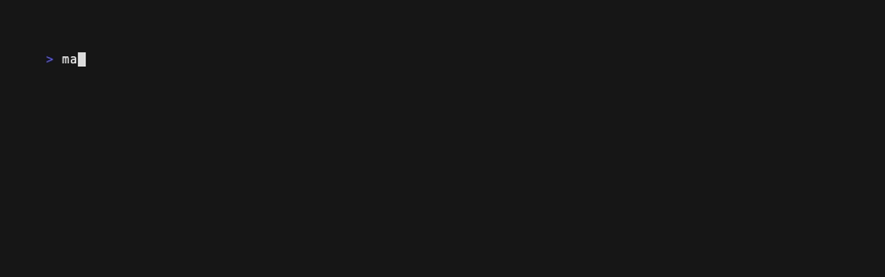
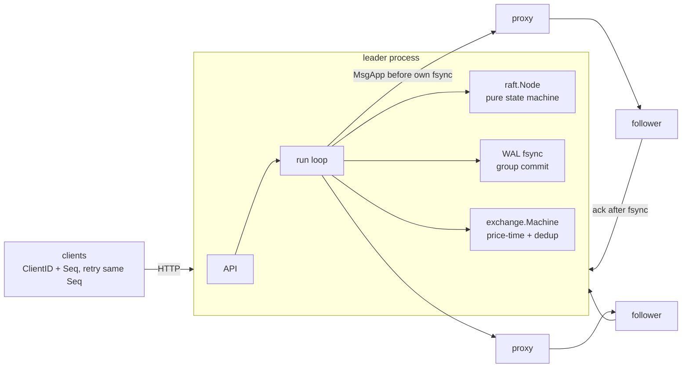

# raftex

A fault-tolerant exchange cluster in Go. A from-scratch Raft implementation (Pre-Vote,
check-quorum, pipelined replication, leader parallel persistence) replicates a sequencer in front
of a deterministic price-time matching engine. Orders are applied exactly once across leader
failover. The cluster is tested by deterministic simulation and by real multi-process chaos
(kill -9, partitions, link delay), with every run checked for lost or duplicated acknowledged
orders and for linearizability.

[](https://github.com/eshaan2418/raftex/actions/workflows/ci.yml)


> Educational/research project. Not investment advice. No live trading. Not a real exchange.

## Headline numbers

3 nodes as local processes on an Apple M5 Pro laptop, every Raft link through a fault-injecting
TCP proxy, HTTP/JSON clients. Raw reports in
[`bench/results/20261102-011736/`](bench/results/20261102-011736/SUMMARY.md).

| metric | value |
|---|---|
| Chaos runs (3 × 60 s, 16 clients, a fault every 3 s: kill -9 leader/follower, isolate leader/follower, link delay) | **98,021 orders, 53 faults: 0 lost acked, 0 double-applied, 0 result mismatches, replicas identical** |
| Leader failover (kill -9 or isolation, 43 events) | new leader p50 **245 ms** (p90 414); client-visible gap p50 **335 ms** |
| Duplicate log entries absorbed by exactly-once dedup | 396 across the fault runs (client retries after commit-but-no-reply) |
| Durable throughput (`F_FULLFSYNC` on leader and followers), 64 clients | **2,338 orders/s**, p50 27 ms (group commit) |
| Without fsync, 64 clients | 29,254 orders/s, p50 2.2 ms |
| Porcupine linearizability (independent checker) | linearizable on 237,853- and 2,570-op histories; times out (120 s) at ≥16 concurrent clients, where the log-witness check is used |
| Raft simulation | 200 seeds × 3,000 steps of drops, duplicates, reordering, partitions, crashes (incl. crash-before-persist): all safety properties hold every step |

## Demo

`make demo`: 8 clients trade while the leader is killed with SIGKILL every 3 s, then every
safety check runs:



Output of one run (`research/results/demo_output.txt`):

```
  kill -9 leader node1: new leader in 174 ms, clients blocked 338 ms
  kill -9 leader node2: new leader in 253 ms, clients blocked 328 ms
  orders completed: 2,185   client retries: 133   duplicate log entries absorbed: 11
  replicas agree: True   lost acked: 0   double-applied: 0   Porcupine: linearizable
```

## Why it matters

An exchange is its sequenced input log. The book, trades, market data and clearing are all
deterministic functions of it. Making that log survive machine failures, without ever losing an
acknowledged order, applying a retried order twice, or letting two sequencers accept orders at
once, is the core availability problem every venue and every internal order-management system
solves. The answer is either a consensus protocol or a primary/backup scheme with the same
guarantees. Getting it subtly wrong (Figure 8, acking before durability, retries without
idempotency) loses real money.

## Highlights

- **Raft from scratch as a pure state machine:**
  - no I/O, no clock;
  - Pre-Vote and check-quorum with leader stickiness;
  - pipelined replication with conflict-term hints;
  - a no-op on election so earlier entries commit (§5.4.2 / Figure 8).
- **Deterministic simulation with mutation checks.** 200 seeds verify election safety, log
  matching, leader completeness and state-machine safety on every step. Removing the vote
  up-to-date check, the current-term commit rule, or the persisted-before-counting rule each makes
  a test fail.
- **Exactly-once orders across failover:**
  - `(ClientID, Seq)` dedup in the replicated state machine;
  - acks only when the committed entry is the one proposed;
  - waiters failed on leadership loss.
- **Leader persistence in parallel with replication.** The leader counts itself toward a majority
  only after its fsync; overlapping fsyncs gave +54-66% durable throughput.
- **Chaos testing on real processes:**
  - SIGKILL with crash recovery from a CRC-framed WAL, which is fuzzed and torn-tail safe;
  - partitions and delay via per-link TCP proxies;
  - a log-as-witness linearizability check plus Porcupine.

## Quick start

```bash
make build test        # build; unit + simulation tests (race detector: make race)
make sim               # 200-seed Raft simulation, verbose
make chaos             # 60 s multi-process chaos run with all checks
make failover          # repeated kill -9 of the leader, failover timing
make bench             # load sweep + failover + 3 chaos seeds (~10 min)

# Run a cluster by hand:
for i in 1 2 3; do bin/raftexd -id $i -raft 127.0.0.1:700$i -client 127.0.0.1:800$i \
  -peers 1=127.0.0.1:7001,2=127.0.0.1:7002,3=127.0.0.1:7003 \
  -clients 1=127.0.0.1:8001,2=127.0.0.1:8002,3=127.0.0.1:8003 -data /tmp/raftex & done
curl -s -XPOST 127.0.0.1:8001/v1/command -d '{"c":1,"q":1,"op":"new","a":1,"s":1,"p":100,"n":5}'
curl -s 127.0.0.1:8002/v1/status
```

## Architecture



**Data flow.** A proposal enters the leader's single run loop. Raft appends it and queues
appends, and the loop batches any other pending proposals. The leader sends appends, then fsyncs.
Followers fsync, then ack. On a durable majority the entry commits, every replica applies it to
the same deterministic engine (order id = log index), and the leader answers the waiting client
only if the committed entry is the one it proposed.

**Threading.** One run-loop goroutine per node owns Raft, the WAL and the state machine (no
locks). Transport goroutines per peer, HTTP handlers communicate through channels. Details:
[`docs/DESIGN.md`](docs/DESIGN.md). Why exchanges do this:
[`docs/MICROSTRUCTURE.md`](docs/MICROSTRUCTURE.md).

## Correctness

| layer | checks |
|---|---|
| Raft unit tests | vote requires up-to-date log, one vote per term, Figure 8, conflicting-tail truncation, reject hints, leader counts itself only after persist |
| Raft simulation | 3/5 nodes, 200 seeds, half without Pre-Vote; drops (10%), duplicates (5%), reordering, partitions, leader-targeted crashes, crash before persist; four safety properties every step; liveness after healing; Pre-Vote non-disruption; check-quorum step-down |
| Mutation checks | the three rules above each produce a failing test when removed |
| WAL | truncation recovery, torn tail, mid-file corruption, fuzzing |
| State machine | matching, dedup (duplicate returns cached result, no state change), stale seq, ownership, determinism across replicas, clone independence |
| Chaos (CI + bench) | replica logs byte-identical; every acked op applied exactly once with the result the client saw; real-time order respected (log as witness); Porcupine |

## Performance

| no faults | clients | orders/s | p50 | p99 | p99.9 |
|---|---|---|---|---|---|
| fsync (`F_FULLFSYNC`) | 4 | 171 | 24.0 ms | 40.0 ms | 45.2 ms |
| fsync | 16 | 603 | 26.9 ms | 39.1 ms | 46.6 ms |
| fsync | 64 | 2,338 | 27.0 ms | 40.0 ms | 43.4 ms |
| no fsync | 4 | 15,857 | 0.25 ms | 0.38 ms | 0.55 ms |
| no fsync | 16 | 26,865 | 0.59 ms | 0.83 ms | 1.38 ms |
| no fsync | 64 | 29,254 | 2.19 ms | 2.80 ms | 4.96 ms |

| failover (43 leader kills/isolations) | p50 | p90 | max |
|---|---|---|---|
| new leader elected after the fault | 245 ms | 414 ms | 659 ms |
| client-observed unavailability | 335 ms | 656 ms | 977 ms |

**Caveats.**
- **Laptop, one machine.** All three processes share a laptop, which also ran an unrelated heavy
  workload during these runs (load averages in `machine.txt`). Network RTT is loopback through a
  user-space proxy.
- **macOS durability.** `F_FULLFSYNC` is about 3.6 ms per call. Linux `fdatasync` on NVMe or
  battery-backed storage would cut the fsync rows' latency by roughly an order of magnitude.
- **Failover** is dominated by the election timeout: 15 × 10 ms ticks, randomized up to 2×.
  Tuning trades faster failover against spurious elections.
- **Porcupine** times out at ≥16 concurrent clients. Those runs rely on the log-witness
  linearizability check, which is exact given that replicas agree and every acked op's result
  matches its log position.

Measured improvements (parallel leader persistence, no fsync for commit-only changes):
[`docs/PERF_LOG.md`](docs/PERF_LOG.md).

## Design decisions and trade-offs

| decision | chosen | rejected, and why |
|---|---|---|
| consensus | Raft, from scratch, pure state machine | etcd/raft (the right production choice; here the goal is to own and test every rule) |
| disruption | Pre-Vote + check-quorum + leader stickiness | plain Raft (rejoining nodes depose healthy leaders) |
| commit of old-term entries | only via a current-term entry (no-op on election) | counting replicas (Figure 8 loses committed entries) |
| leader persistence | send first, count self after fsync | persist then send (2× latency) / count self immediately (unsafe) |
| idempotency | (ClientID, Seq) + cached result in the state machine | dedup at the gateway (lost on failover) |
| order ids | log index | per-node counters (would diverge) |
| linearizability check | log witness (exact, scalable) + Porcupine (independent, bounded) | Porcupine alone (does not scale to 30k-op concurrent histories) |

## Limitations and roadmap

- Snapshots and log compaction. Membership changes (joint consensus).
- Binary pipelined client protocol. Leader leases or ReadIndex for linearizable book reads off
  the log.
- Sharding instruments across Raft groups.
- Linux benchmarks on NVMe with `fdatasync`. Network-level faults with `tc netem`.
- Wire the C++ [matchbox](https://github.com/eshaan2418/matchbox) engine in as the state machine
  (cgo or a sidecar), with this cluster as its replicated sequencer.

## Related projects

- [matchbox](https://github.com/eshaan2418/matchbox): single-node C++ matching engine with
  journal replay. raftex is its replicated, fault-tolerant counterpart.
- [itchbook](https://github.com/eshaan2418/itchbook), [marketmux](https://github.com/eshaan2418/marketmux):
  market-data side of the stack.

## Project structure

```
internal/raft       Raft core (pure), unit tests, deterministic cluster simulation
internal/wal        CRC-framed write-ahead log, recovery, fuzzing
internal/exchange   replicated state machine: price-time engine + exactly-once dedup
internal/transport  TCP transport (gob streams per peer)
internal/node       replica process: run loop, persistence ordering, client API
internal/client     leader discovery, same-Seq retries
internal/chaos      fault proxies, process cluster, workload, nemesis, checkers (+ Porcupine)
cmd/raftexd         node binary          cmd/raftexchaos   chaos / failover / load harness
docs/               DESIGN, MICROSTRUCTURE, PERF_LOG, DEEP_DIVE
```

## License

MIT. See [LICENSE](LICENSE). Educational/research project. Not investment advice. No live trading.
